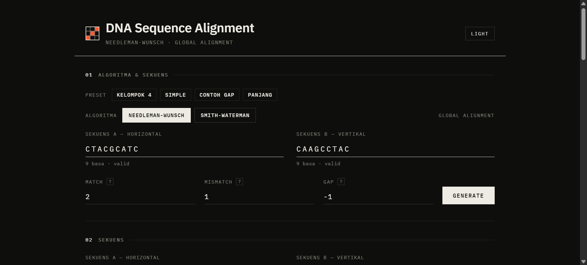
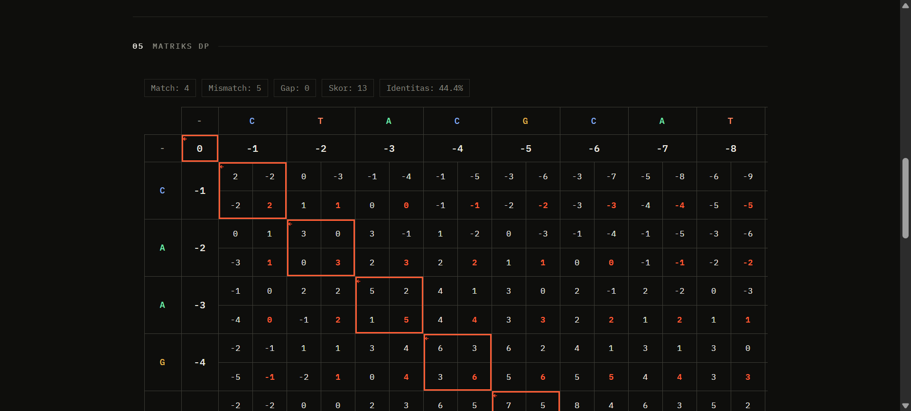

<p align="center">
  
</p>

<h1 align="center">SeqAlign</h1>

<p align="center">
  Visualisasi interaktif <b>Needleman-Wunsch</b> (global) dan <b>Smith-Waterman</b> (local)<br/>
  untuk sequence alignment DNA — langkah demi langkah, sel demi sel.
</p>

<p align="center">
  <a href="https://zmy16.github.io/seqalign/"><b>Lihat demo →</b></a>
</p>

<p align="center">
  
  
  
  
</p>



## Kenapa SeqAlign

Algoritma alignment DNA biasanya diajarkan sebagai rumus. Di sini matriksnya bisa diisi satu sel
seperti menonton perhitungan ditulis di papan: setiap sel menampilkan tiga kandidat nilai
(diagonal, atas, kiri) beserta nilai MAX yang dipakai, lengkap dengan penjelasan angkanya.



## Fitur

- **Dua algoritma** — Needleman-Wunsch (global) dan Smith-Waterman (local), bisa berganti tanpa reload.
- **Langkah demi langkah** — isi matriks sel per sel, atau isi semua sekaligus.
- **Penjelasan per sel** — breakdown `diagonal + skor`, `atas + gap`, `kiri + gap`, lalu MAX.
- **Traceback visual** — jalur optimal ditandai garis aksen, hasil alignment ditampilkan berjajar.
- **Preset sekuens** — Kelompok 4, Simple, Contoh Gap, Panjang.
- **Skor bisa diatur** — match, mismatch, dan gap penalty.
- **Ekspor** — matriks ke PNG dan Excel (`.xlsx` asli, ditulis tanpa library eksternal).
- **Tema terang/gelap** — dua palet penuh, kontras terjaga di keduanya.
- **Keyboard** — `Enter` langkah, `F` isi semua, `T` traceback, `Ctrl+Z` mundur, `Esc` tutup dialog.

## Cara pakai

1. Buka `index.html` di browser (tidak perlu install apa pun), atau pakai [demo online](https://zmy16.github.io/seqalign/).
2. Pilih **algoritma**, isi **Sekuens A** dan **Sekuens B** (A/C/G/T/N, maksimal 15 basa), atau pilih preset.
3. Atur **match / mismatch / gap** bila perlu, lalu klik **Generate**.
4. Jalankan **Langkah →**, **Isi semua**, lalu **Traceback**.

## Preset

| Preset | Sekuens A | Sekuens B | Match | Mismatch | Gap |
|---|---|---|---|---|---|
| Kelompok 4 | `CTACGCATC` | `CAAGCCTAC` | +2 | +1 | −1 |
| Simple | `ACGT` | `AGT` | +2 | −1 | −2 |
| Contoh Gap | `AGTACG` | `ACATAG` | +2 | +1 | −1 |
| Panjang | `ATCGATCGATCG` | `ATGCATGCATGC` | +1 | −1 | −2 |

## Cara kerja singkat

**Needleman-Wunsch (global)**

1. Baris dan kolom pertama diisi kelipatan gap penalty.
2. Tiap sel: `MAX(diagonal + match/mismatch, atas + gap, kiri + gap)`.
3. Traceback dari pojok kanan bawah ke kiri atas.

**Smith-Waterman (local)**

1. Baris dan kolom pertama diisi 0.
2. Tiap sel: `MAX(0, diagonal + match/mismatch, atas + gap, kiri + gap)` — nilai negatif dipangkas ke 0.
3. Traceback dari sel berskor tertinggi, berhenti saat mencapai 0.

## Struktur proyek

```
seqalign/
├── index.html          # Struktur halaman, dialog, dan formulir
├── assets/
│   ├── logo.svg        # Mark: mini-matriks DP dengan jalur diagonal
│   ├── script.js       # Algoritma DP, traceback, render, ekspor
│   ├── style.css       # Design tokens + seluruh styling
│   ├── preview-top.png
│   └── preview-matrix.png
├── .github/workflows/  # Deploy otomatis ke GitHub Pages
└── README.md
```

## Teknologi

- **HTML + CSS + JavaScript vanilla** — tanpa framework, tanpa build step, tanpa `node_modules`.
- **IBM Plex Sans & Plex Mono** — satu superfamily: teks dan angka.
- **html2canvas** (lazy-loaded dari CDN, hanya saat ekspor PNG).
- **Excel writer sendiri** — `.xlsx` dirakit sebagai ZIP (`crc32` + header) berisi XML SpreadsheetML.
- **Content-Security-Policy** ketat, semua data pengguna di-escape sebelum masuk DOM.

## Desain

Arah visualnya "sequence plate": kertas dan tinta, garis rambut 1px, satu aksen (vermilion) yang
hanya dipakai untuk menandai **nilai MAX** dan **jalur traceback**. Hierarki dibentuk oleh bobot
dan ukuran huruf, bukan oleh warna — semua angka memakai `tabular-nums` supaya kolom tidak bergeser
saat matriks terisi.

## Lisensi

Dibuat untuk keperluan edukasi (Bioinformatika).
